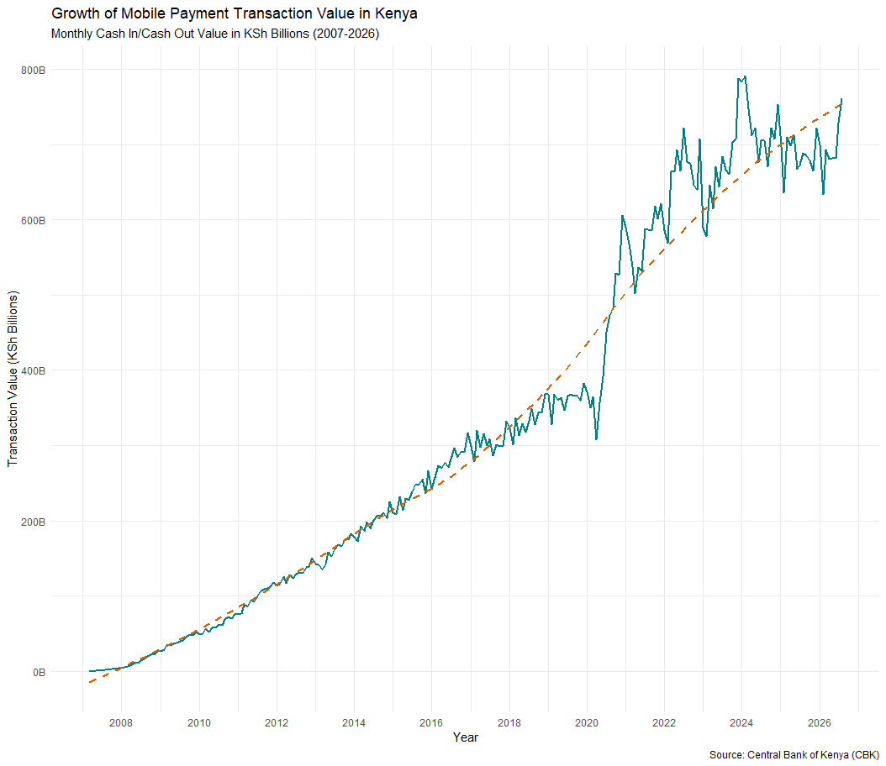
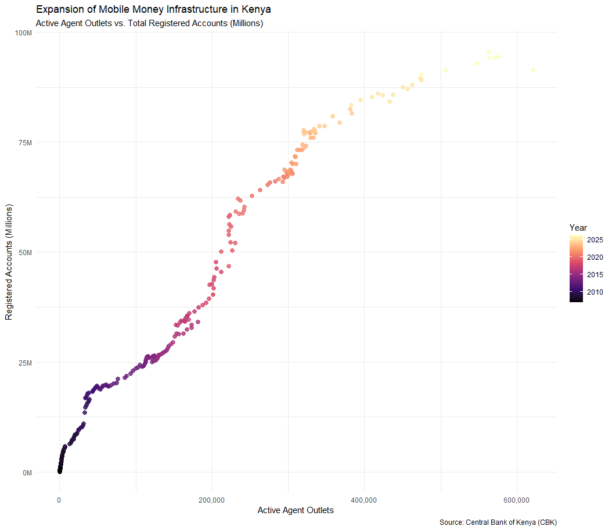
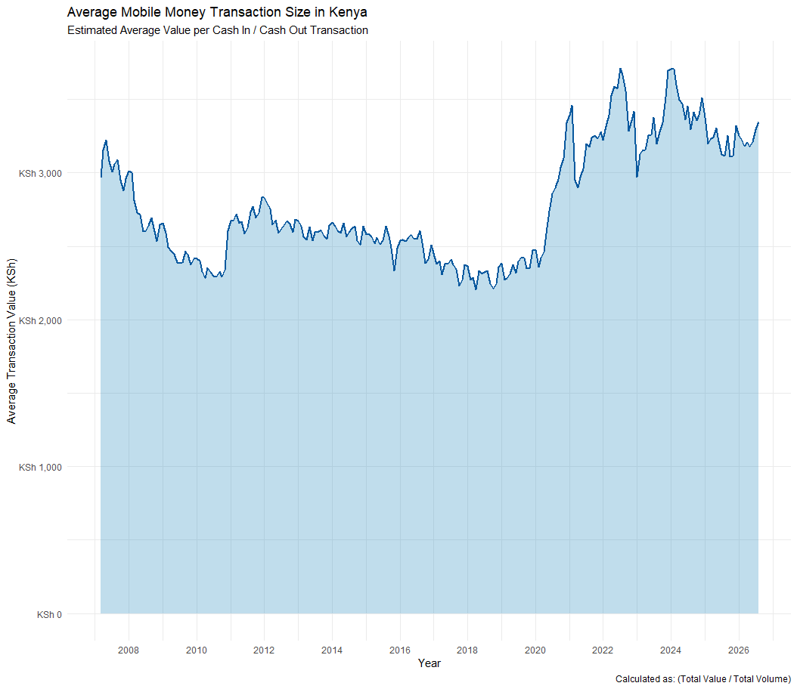

# Kenya Mobile Money and Financial Inclusion Analysis (2007–2026)

##  Project Overview
This project analyzes the historical growth and adoption of mobile money services in Kenya using monthly macroeconomic data published by the **Central Bank of Kenya (CBK)**. 

The objective is to examine key trends in transaction volumes, agent network expansion, and average transaction values over a 19-year period to understand how mobile financial infrastructure has evolved.

---

##  Key Highlights and Findings
* **Transaction Value Growth:** Monthly cash-in/cash-out transaction values grew exponentially from under **KSh 1 Billion** in 2007 to over **KSh 750 Billion** per month.
* **Infrastructure Scaling:** Active agent outlets expanded from under **1,000 agents** in 2007 to over **570,000 active outlets**, driving deep last-mile financial access.
* **Structural Shift in Usage:** Average transaction sizes remained between KSh 2,000–2,500 for over a decade before surging past **KSh 3,500+ post-2020**, reflecting increased digital payment utility for B2B and merchant transactions.

---

## ️ Tools and& Technologies Used
* **Language:** R (v4.6+)
* **Libraries:** `tidyverse` (`dplyr`, `ggplot2`, `readr`), `janitor`, `lubridate`, `scales`, `zoo`
* **Data Source:** Central Bank of Kenya (CBK) Mobile Payments Statistics

---

##  Visualizations and Insights

### 1. Growth of Mobile Payment Transaction Value

*Figure 1: Monthly cash-in/cash-out transaction values in KSh Billions (2007–2026) showing strong post-2020 acceleration.*

### 2. Infrastructure Expansion: Agents vs. Registered Accounts

*Figure 2: Scaling relationship between active agent outlets and total registered accounts (Millions).*

### 3. Evolution of Average Transaction Size

*Figure 3: Estimated average value per transaction (KSh) showing structural shifts in consumer usage over time.*

---

## Author
**Yvone Okumu**  
*B.Sc. Statistics Student, University of Nairobi*
